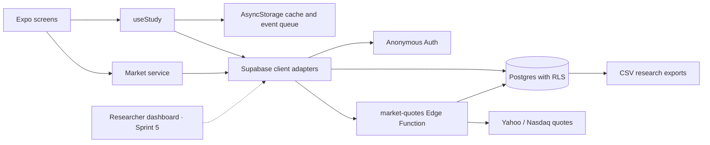

# Architecture and code-review walkthrough

## Two separate kinds of trading

The ownership lesson uses a fixed $225 → $210 example to teach uncertainty. The earlier gain/loss comparison is disabled; historical server-assigned variants remain stored but are unused by the lesson. Guided purchases independently use market quotes and record virtual transactions. `content.ts` does not determine the server's execution price.

## Boundaries

Screens render and gather intent. `useStudy` owns session/progress lifecycle. Service modules own network and persistence details. Shared contracts are in `domain.ts`, with stable question IDs and content in `content.ts`. There is one reusable flow for both lessons, rather than a separate lesson implementation per topic or a generalized course engine.

Each lesson draft stores its step, selections, submitted-answer flags, and confidence. Local writes and progress uploads are serialized; navigation uses the latest draft. Restoring a pending device snapshot preserves any completion already committed by the server. Each lesson has one guided purchase; Home provides a read-only portfolio rather than free trading or selling.

The backend is authoritative for session variant, virtual cash, holdings, simulated execution price, transactions, and once-per-lesson rewards. Mobile progress JSON is learner-owned and supports navigation/results; it is not an authorization mechanism. API functions verify `auth.uid()`, and row-level security restricts records to the owning anonymous account. A future researcher dashboard will need a separate authorized read model; normal learners cannot read everyone else's research records.

## Interaction to present: lesson completion

1. `LearningScreen` saves each first answer and emits a stable-ID question event before showing corrective feedback.
2. `App` passes the final result to `useStudy.finish`.
3. `complete_lesson` validates the payload and serializes access to the active session. It records a $1,000 reward once, even if the request is repeated.
4. The client caches the completed result and synchronizes progress, then opens guided Practice.
5. Reviewing a completed lesson keeps the original result and does not award another reward.

Incorrect first attempts are valid study observations. Completing the explained lesson is what earns the reward, not having every first answer correct.

## Interaction to present: a practice order

1. `MarketScreen` loads quotes and holdings and validates whole-share input. Pressing Buy records the reasoning attempt and shows feedback; a correct reason is required to purchase. Lesson 2 also requires a sector outside all current holdings.
2. It saves an order UUID and its original intent in a per-session local outbox.
3. `place_lesson_trade` checks the lesson reward, first-trade requirement, sector, correct reason, and one-purchase limit. It uses the internal `place_trade` function for quote age, funds, and server-price execution; authenticated clients cannot call `place_trade` directly.
4. Cash, holding quantity, the immutable transaction, and the per-lesson `lesson_trades` record are updated atomically.
5. A retry with the same UUID returns the original transaction. Conflicting reuse is rejected.
6. The client clears the outbox after confirmation and refreshes the portfolio. A timeout remains unresolved until retried with the same ID.

Quote-source time and fetch time are distinct. A five-minute cache is not a claim that the exchange price is real-time. A quote older than the server's permitted freshness window cannot execute a trade. Missing holding valuations are labeled unavailable, not presented as zero-value holdings.

## Data collection

Sessions hold baseline/progress/results and the historical assigned variant. Events hold question IDs, selected answers, phase, timing, navigation, confidence, and trade intent. Trades separately hold simulated fills. Events are queued before upload, and unique IDs make duplicate uploads safe. Client timing is approximate. Matched two-question knowledge summaries do not mix confidence into the score. Analyze `sprint4.v4` content and events separately from v2/v3.

The in-app CSV contains the current anonymous account's sessions. An administrator can use `supabase/export.sql` for team-wide data without granting learners broader access. Integration-test sessions are excluded by an explicit event marker. No study conclusions are inferred from integration tests.

## Review and demonstration sequence

1. Show baseline neutrality and the sequential lesson path. Onboarding offers “I don’t know yet”; lesson questions do not.
2. Tap bakery shares or switch diversification baskets; submit one incorrect answer and inspect explicit feedback.
3. Show the fixed $225 → $210 lesson example.
4. Complete the lesson; inspect its first-attempt result and once-only reward.
5. Open guided practice, inspect quote/source/time, submit reasoning with Buy, and inspect the persisted purchase.
6. Exit and reload a partial lesson to demonstrate resume; inspect the read-only portfolio from Home. Show raw CSV fields, not invented participant findings.
7. Explain `supabase/tests.sql`: reward idempotency, duplicate orders, insufficient funds, and cross-user isolation.
8. Identify the researcher dashboard as planned for Sprint 5; it is not part of this build.

## Deliberate simplifications

Two lessons and five symbols; whole shares; USD; no fees/order book/slippage model; no real-money orders; no full registration or cross-device recovery. Market endpoints are unofficial and may change or block requests. An early-adopter release needs provider-terms review and additional physical-device testing.
